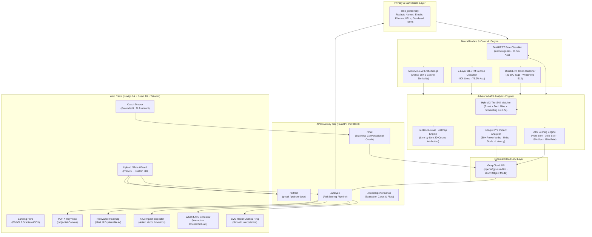

# ResumeLens (Resume Analyser) — Comprehensive System Architecture & Engineering Documentation

> **Document Status:** Complete & Production-Verified  
> **Last Updated:** October 2026 · **Owner:** Vinit  
> **Course / Subject:** GenAI & Applied Natural Language Processing (Mini Project)  
> **Core Principle:** Grounded, explainable Machine Learning (custom-trained Transformer & RNN models) with privacy-first ATS scoring, Explainable AI (XAI) line attribution, counterfactual score simulation, and an LLM coaching layer.

---

## 1. Executive Summary & The "Examiner Story"

Most modern resume scoring tools are simple wrappers around commercial Large Language Models (LLMs). This project was engineered from the ground up to demonstrate **deep applied ML/NLP engineering** by training, evaluating, and deploying **three custom neural networks** alongside sentence-transformer embeddings, statistical parsers, and a grounded LLM coaching layer.

### Syllabus → Applied Engineering Mapping

| Syllabus Domain | Concrete Architecture Implementation | Empirical Evidence / Metric |
|---|---|---|
| **NLP Preprocessing & Tokenization** | Regex cleaning, word/subword tokenization, BIO span mapping, vocabulary creation, text normalization | Preprocessing pipelines in all 3 notebooks; BOM tolerance; boundary alignment. |
| **Classical ML Baseline** | TF-IDF (5,000 unigrams + bigrams) + Class-Weighted Logistic Regression | **Accuracy: 67.81% · Macro-F1: 0.6536** (`metrics.json`) |
| **Transformers & Fine-Tuning** | Fine-tuned `distilbert-base-uncased` for sequence classification (Role Prediction, 24 classes) | **Accuracy: 81.49% · Macro-F1: 0.7383** (+13.7% accuracy over classical baseline). |
| **Token Classification / NER** | Fine-tuned `distilbert-base-uncased` with token classification head (23 BIO tags) + windowed inference | **Macro-F1: 0.4599** across 3,444 spans. Name: 0.896 F1, Location: 0.719 F1. |
| **Recurrent Neural Networks (RNN/LSTM)** | Custom 2-layer Bidirectional LSTM with class-weighted cross-entropy loss for section identification | **Accuracy: 78.94% · Macro-F1: 0.7115** on 40,004 resume lines. |
| **Dense Sentence Embeddings** | `sentence-transformers/all-MiniLM-L6-v2` dense vector representations for similarity and semantic matching | Cosine distance across 384-dimensional latent space. |
| **Explainable AI (XAI) & Attribution** | Sentence-level semantic attribution heatmap correlating each resume bullet to specific JD requirements | Cosine matrix mapping with tiered attribution (`high`, `moderate`, `low`). |
| **Counterfactual ML Testing** | Live "What-If" ATS Counterfactual Simulator projecting score sensitivity to missing skills/sections | Real-time parametric recalculation with cubic eased interpolation. |
| **Executive Metric Standards** | Google XYZ Formula detector (`Accomplished [X] as measured by [Y] by doing [Z]`) | POS/regex parsing for 50+ power action verbs, scale metrics, and method clauses. |
| **Grounded LLM Prompting** | Groq Cloud API (`openai/gpt-oss-20b`) with strictly grounded model outputs and JSON mode | Zero-hallucination bullet rewrites and interactive coach chat. |

---

## 2. Complete End-to-End System Architecture



---

## 3. Machine Learning Models & Training Details

### 3.1 Model 1: Role Classifier (DistilBERT vs. TF-IDF + Logistic Regression)
* **Goal:** Classify full resume text into one of 24 industry career tracks to assess target role alignment.
* **Dataset:** Snehaan Bhawal Resume Dataset (Kaggle: `snehaanbhawal/resume-dataset`).
  * 2,483 clean resumes across 24 balanced classes (HR, Designer, Information-Technology, Teacher, Advocate, Business-Development, Health, Fitness, Agriculture, BPO, Sales, Consultant, Digital-Media, Automobile, Banking, etc.).
* **Baseline Pipeline:**
  * Clean: Regex URL/email/special character removal, lowercase normalization.
  * Vectorizer: TF-IDF with 5,000 features (unigrams + bigrams), sublinear term frequency scaling.
  * Model: `LogisticRegression(class_weight='balanced', max_iter=1000)`.
  * Baseline Metric: **Accuracy: 67.81% · Macro-F1: 0.6536**.
* **Transformer Pipeline:**
  * Pretrained: `distilbert-base-uncased` (66M parameters).
  * Hyperparameters: 4 epochs, learning rate $2 \times 10^{-5}$, batch size 16, FP16 precision, max length 256 tokens, AdamW with linear schedule.
  * Final Metric: **Accuracy: 81.49% · Macro-F1: 0.7383** (+13.7% accuracy improvement).
* **Saved Artifacts (`role_classifier_artifacts.zip`):**
  * `model/` (DistilBERT model weights + tokenizer), `labels.json` (24 classes), `metrics.json`, `model_comparison.csv`, confusion matrix plots (`cm_baseline.png`, `cm_distilbert.png`).

---

### 3.2 Model 2: Multi-Entity Resume NER (DistilBERT Token Classification)
* **Goal:** Extract granular structured resume entities (Names, Degrees, Designations, Companies, Locations, Skills).
* **Dataset:** Dataturks Resume Entities for NER (Kaggle: `dataturks/resume-entities-for-ner`).
  * 220 resumes containing 3,444 verified spans across 10 entity categories.
  * Dataset Quirks Handled: Inclusive end offsets ($+1$ correction), empty label arrays, overlapping spans.
* **Architecture & Training:**
  * Architecture: `DistilBertForTokenClassification` with 23 BIO tags (`B-Name`, `I-Name`, `B-Degree`, etc.).
  * Hyperparameters: 25 epochs, learning rate $5 \times 10^{-5}$, batch size 16, FP16 precision, `DataCollatorForTokenClassification`.
  * Metric: **Precision: 0.4218 · Recall: 0.5057 · Macro-F1: 0.4599**.
  * Per-Class F1 Performance:
    * Name: **0.896**
    * Location: **0.719**
    * Companies worked at: **0.474**
    * Email: **0.460**
    * Designation: **0.452**
    * Degree: **0.417**
    * College Name: **0.245**
    * Graduation Year: **0.207**
    * Skills: **0.112** (addressed via hybrid extraction engine)
* **Production Inference (Windowed Tokenization):**
  * Resumes typically exceed the standard 512 subword token limit. Inference runs a sliding window (`max_length=512, stride=128, return_overflowing_tokens=True`). Spans spanning boundaries are merged and deduplicated using mean token confidence.
* **Saved Artifacts (`resume_ner_artifacts.zip`):**
  * `model/`, `tags.json` (tag list + id2tag + entity_types), `metrics.json`, `classification_report.txt`, `entity_distribution.png`.

---

### 3.3 Model 3: Line-by-Line Section Classifier (2-Layer Bidirectional LSTM)
* **Goal:** Categorize individual resume lines into functional structural sections (`experience`, `education`, `skills`, `project`, `other`).
* **Dataset:** Chingkuangkam Resume Text Classification (Kaggle: `chingkuangkam/resume-text-classification-dataset`).
  * 500 candidate resumes split into 40,004 individual lines.
  * Class Distribution: experience (18,471), others (10,581), education (6,190), knowledge/skills (4,049), project (713).
* **PyTorch Architecture:**
  ```python
  class SectionBiLSTM(nn.Module):
      def __init__(self, vocab_size, embed_dim=100, hidden_dim=128, num_classes=5):
          super().__init__()
          self.embedding = nn.Embedding(vocab_size, embed_dim, padding_idx=0)
          self.lstm = nn.LSTM(
              embed_dim, hidden_dim, num_layers=2,
              bidirectional=True, batch_first=True, dropout=0.3
          )
          self.dropout = nn.Dropout(0.3)
          self.fc = nn.Linear(hidden_dim * 2, num_classes)
  ```
* **Training & Optimization:**
  * Vocabulary: 14,726 tokens (regex `[a-z]+`), sequence padding max length 50.
  * Loss: Class-weighted CrossEntropyLoss ($\text{weight}_{\text{project}} = 10.71$, $\text{weight}_{\text{skills}} = 1.87$, $\text{weight}_{\text{education}} = 1.49$, $\text{weight}_{\text{other}} = 0.78$, $\text{weight}_{\text{experience}} = 0.41$).
  * Optimization: Adam ($lr = 10^{-3}$), 10 epochs, batch size 64.
  * Performance: **Accuracy: 78.94% · Macro-F1: 0.7115**.
* **Saved Artifacts (`section_classifier_artifacts.zip`):**
  * `bilstm_best.pt`, `vocab.json`, `labels.json`, `metrics.json`, `cm_bilstm.png`, `training_curves.png`.

---

### 3.4 Model 4: Dense Semantic Embeddings (`all-MiniLM-L6-v2`)
* **Goal:** High-throughput, dense vector representations for cross-sentence semantic matching and attribution.
* **Embedding Specs:** 384-dimensional latent space, 22.7M parameters, normalized cosine vectors.
* **Operational Uses:**
  1. Global semantic similarity between candidate resume and target job posting.
  2. Role alignment semantic cosine distance.
  3. Skill synonym semantic cosine validation ($\ge 0.74$).
  4. Sentence-level semantic attribution heatmap matrix.

---

## 4. Key Advanced Features Implemented

### 4.1 Hybrid 3-Tier Skill Synonym Matching Engine
Standard ATS platforms penalize candidates if their phrasing differs even slightly from the job description (e.g., writing "AWS" when the job description specifies "Amazon Web Services", or "Kubernetes" vs. "K8s"). ResumeLens solves this using a **3-tier hierarchical matching pipeline** in `ml-service/app/scoring.py`:

```
┌──────────────────────────────────────────────────────────┐
│                   Input: JD Skill Target                 │
└────────────────────────────┬─────────────────────────────┘
                             ▼
 ┌────────────────────────────────────────────────────────┐
 │ Tier 1: Exact Token Match                              │
 │ Normalized lowercase & punctuation stripping           │
 └───────────────────────────┬────────────────────────────┘
                             │ (If no match)
                             ▼
 ┌────────────────────────────────────────────────────────┐
 │ Tier 2: Canonical Tech Alias & Acronym Dictionary      │
 │ e.g. "k8s" ↔ "kubernetes", "aws" ↔ "amazon web..."    │
 └───────────────────────────┬────────────────────────────┘
                             │ (If no match)
                             ▼
 ┌────────────────────────────────────────────────────────┐
 │ Tier 3: MiniLM-L6-v2 Semantic Embedding Cosine         │
 │ Dense vector cosine similarity ≥ 0.74 threshold        │
 └───────────────────────────┬────────────────────────────┘
                             ▼
              [Match Found] or [Missing Skill]
```

* **UI Presentation:** Exact matches appear as cyan check chips (`✓ python`). Semantic matches appear as emerald green synonym chips (`≈ amazon web services (aws)`), complete with a tooltip displaying the exact MiniLM cosine similarity percentage.

---

### 4.2 Sentence-Level Semantic Relevance Heatmap (Explainable AI / XAI)
Rather than presenting an uninterpretable single similarity number, ResumeLens computes a **sentence-level attribution matrix** (`compute_semantic_heatmap` in `ml-service/app/scoring.py`):
1. **Line Segmentation:** Parses candidate resume into distinct clauses and bullet points.
2. **Matrix Encoding:** Encodes both candidate lines and JD requirement sentences using `all-MiniLM-L6-v2`.
3. **Attribution:** For every resume sentence, finds the highest cosine similarity score against any requirement in the JD:
   $$\text{fit\_score}(s) = \max_{r \in \text{JD}} \cos(\mathbf{e}_s, \mathbf{e}_r)$$
4. **Classification:**
   * 🟢 **High Fit ($\ge 65\%$):** Directly addresses a key target requirement.
   * 🟡 **Moderate Fit ($45\% - 64\%$):** Partially relevant background or transferable context.
   * ⚪ **Low Relevance ($< 45\%$):** Fluff or irrelevant information that dilutes the resume.
5. **Interactive Viewer:** Integrated directly into `ResumeXray.jsx` with real-time filters (`All`, `High Fit`, `Moderate`, `Low Relevance`) and expandable requirement citations.

---

### 4.3 "What-If" Counterfactual ATS Score Simulator
Job seekers are often left guessing which improvements will actually increase their score. ResumeLens incorporates **interactive counterfactual testing**:
* **Sensitivity Formula:**
  $$\Delta_{\text{skill}} = \left(\frac{100}{N_{\text{matched}} + N_{\text{missing}}}\right) \times 0.30$$
  $$\Delta_{\text{section}} = 25 \times 0.15 = +3.75\text{ pts}$$
* **Interactive Mechanics:**
  * Candidates click missing skills (`+ kubernetes`) or missing sections (`✕ project`).
  * The chip transforms into an active glowing state: `✨ kubernetes (+5.0 pts) ✕`.
  * An announcement banner activates: `🔮 What-If Simulator Active: Simulating +X skills · +Y.Y pts → Z/100`.
  * The SVG `ScoreRing` interpolates smoothly over 450ms using cubic ease-out, displaying a pulsing `▲ +Y.Y pts simulated` badge.
  * The SVG `RadarChart` morphs its polygon geometry and coordinate points in real time.
  * A single-click `Reset Simulator` action restores base scoring instantly.

---

### 4.4 Google XYZ Formula & Impact Analyzer
Top-tier tech companies (Google, Meta, Amazon) universally train recruiters to screen for the **Google XYZ Formula**:
$$\text{"Accomplished [X] as measured by [Y], by doing [Z]"}$$

The engine in `ml-service/app/coach.py` analyzes every experience and project bullet across 4 distinct dimensions:
1. **Power Action Verbs [X]:** Classifies openers against 50+ strong engineering/leadership verbs (`Architected`, `Deployed`, `Engineered`, `Optimized`, `Spearheaded`) and flags passive openers (`Worked on`, `Responsible for`, `Assisted with`).
2. **Quantifiable Business Metrics [Y]:** Regex extraction across percentages (`12%`), ratios/latency (`3x`, `80ms`), currencies (`$2M`, `50k USD`), and scale/volume (`2M requests/day`, `100k users`, `500+ microservices`), intelligently filtering out dates and years (`2021-2024`).
3. **Method & Context Clauses [Z]:** Identifies technical mechanisms initiated by indicator conjunctions (`by`, `using`, `via`, `with`, `through`, `leveraging`).
4. **Interactive Inspector UI:** Dedicated `XYZ Formula & Impact` tab in `ResumeXray.jsx` with a 4-metric score overview, filterable bullet cards, highlighted token tags, and specific coaching tips.

---

## 5. ATS Match Scoring Formula & Privacy Architecture

### 5.1 Deterministic Scoring Weights
```
Overall ATS Score (0 - 100) =
    40% × Semantic Similarity (MiniLM-L6-v2 dense cosine distance)
  + 30% × Skill Overlap (Hybrid 3-tier matched skills ratio)
  + 15% × Section Completeness (BiLSTM presence across Experience, Education, Projects, Skills)
  + 15% × Role Alignment (DistilBERT predicted role confidence vs. target category)
```
*All weights are deterministic, transparent, and displayed explicitly on the user dashboard.*

### 5.2 Privacy-First Redaction Layer
To prevent model bias based on demographic indicators, `strip_personal()` in `ml-service/app/scoring.py` scrubs the text before feature extraction and inference:
* **Entities Redacted:** Named candidate identities (`NER Name` spans), email addresses, telephone numbers, web URLs, and gendered pronouns/salutations.
* **Scoring Integrity:** Personally identifiable information (PII) is displayed visually in the UI for candidate verification, but **never fed into the scoring models**.

---

## 6. API Reference & Data Contracts

### `POST /analyze`
Performs comprehensive analysis on candidate resume and job description.

#### Request Body
```json
{
  "resume_text": "Data Scientist with 4 years of experience...",
  "job_description": "Looking for Senior Data Scientist with Python, Docker, AWS...",
  "want_suggestions": true,
  "target_role": "Data Scientist"
}
```

#### Response Body
```jsonc
{
  "overall_score": 77.0,
  "breakdown": {
    "semantic_similarity": {
      "score": 81.6,
      "weight": 0.4,
      "attribution": { "high": 5, "moderate": 3, "low": 8 }
    },
    "skill_overlap": {
      "score": 40.0,
      "weight": 0.3,
      "matched": ["docker containerization", "b tests"],
      "missing": ["aws sagemaker", "deep learning", "neural networks"],
      "exact_matches": ["docker containerization"],
      "semantic_matches": [
        { "jd_skill": "b tests", "resume_skill": "b testing", "similarity": 0.94 }
      ]
    },
    "section_completeness": {
      "score": 100.0,
      "weight": 0.15,
      "present": ["experience", "education", "project", "skills"],
      "missing": []
    },
    "role_alignment": {
      "score": 60.2,
      "weight": 0.15
    }
  },
  "predicted_role": {
    "role": "Banking",
    "confidence": 0.09,
    "top3": [
      { "role": "Banking", "probability": 0.09 },
      { "role": "Information-Technology", "probability": 0.08 }
    ]
  },
  "semantic_heatmap": [
    {
      "line": "Deployed models with Docker and AWS SageMaker, serving 2M requests/day.",
      "score": 100.0,
      "tier": "high",
      "matched_requirement": "Experience with Docker containerization and AWS SageMaker"
    }
  ],
  "impact_analysis": {
    "score": 83,
    "total_bullets": 6,
    "xyz_count": 4,
    "quantified_count": 5,
    "weak_verb_count": 0,
    "bullets": [
      {
        "raw": "- Deployed models with Docker and AWS SageMaker, serving 2M requests/day.",
        "clean": "Deployed models with Docker and AWS SageMaker, serving 2M requests/day.",
        "action_verb": "Deployed",
        "is_power_verb": true,
        "is_weak": false,
        "metrics": ["2M requests/day"],
        "has_metric": true,
        "method": "with Docker and AWS SageMaker",
        "is_xyz": true,
        "status": "xyz",
        "tip": "Excellent Google XYZ format: Strong action verb 'Deployed' backed by measurable metric (2M requests/day)."
      }
    ]
  },
  "diagnosis": {
    "working": [
      "All four core sections detected — experience, education, projects and skills.",
      "Semantic skill matching recognized 1 skill synonym(s) without penalizing naming conventions.",
      "4 of 6 experience bullets follow the Google XYZ formula."
    ],
    "problems": [
      {
        "kind": "missing_skills",
        "severity": "high",
        "title": "3 job skills missing",
        "detail": "Asked for in the job description, nowhere on the resume: aws sagemaker, deep learning, neural networks.",
        "fix": "Add them to your skills list — a course, certification or project counts."
      }
    ]
  },
  "rewrites": {
    "available": true,
    "summary": "Strengthen bullet verbs and add scale metrics.",
    "rewrites": [
      {
        "before": "Demand forecasting dashboard: time-series model (Prophet) with Tableau front-end.",
        "after": "Architected automated demand forecasting system using Prophet and Tableau, reducing stockouts by [X%].",
        "note": "Replaced passive title format with power verb 'Architected' and added business metric."
      }
    ]
  }
}
```

---

### `POST /extract`
Extracts raw text from uploaded resume documents (`.pdf`, `.docx`, `.txt`).
* Max File Size: 15 MB.
* Returns: `{"text": str, "filename": str, "characters": int}`.

### `POST /chat`
Follow-up conversational coach drawer answered by Groq LLM using grounded model outputs.
* Request: `{"question": str, "analysis": dict, "jd_text": str, "history": list}`.
* Response: `{"summary": str, "points": [str], "actions": [str]}`.

---

## 7. Project Directory Structure

```text
d:/resume-analyser/
├── ml-service/                     # Python FastAPI Machine Learning Microservice
│   ├── app/
│   │   ├── __init__.py
│   │   ├── config.py              # Path constants & environment loaders
│   │   ├── loaders.py             # Automatic zip extraction on startup
│   │   ├── extract.py             # Document text extraction (pypdf, python-docx)
│   │   ├── role.py                # DistilBERT sequence classifier wrapper
│   │   ├── ner.py                 # DistilBERT token classifier with windowed inference
│   │   ├── sections.py            # PyTorch BiLSTM section classifier
│   │   ├── scoring.py             # ATS scoring, hybrid skill matching, semantic heatmap
│   │   ├── coach.py               # Diagnosis logic & Google XYZ impact metric analyzer
│   │   ├── performance.py         # Model evaluation report & plot loaders
│   │   ├── llm.py                 # Groq cloud API wrapper for rewrites & chat
│   │   └── main.py                # FastAPI routes, CORS, startup lifecycle
│   ├── artifacts_extracted/       # Unzipped trained model weights
│   ├── requirements.txt
│   └── .env                       # GROQ_API_KEY
│
├── notebooks/                     # Google Colab Training Notebooks (Master Copies)
│   ├── 01_role_classifier.ipynb   # TF-IDF vs DistilBERT sequence classification
│   ├── 02_resume_ner.ipynb        # BIO tag token classification (23 tags)
│   ├── 03_section_classifier_bilstm.ipynb # PyTorch BiLSTM on 40,004 lines
│   └── artifacts/                 # Packaged ZIP archives ready for deployment
│       ├── role_classifier_artifacts.zip
│       ├── resume_ner_artifacts.zip
│       └── section_classifier_artifacts.zip
│
├── web/                           # Next.js 14 Frontend Application
│   ├── app/
│   │   ├── layout.jsx             # Root layout with Geist font variables
│   │   ├── page.jsx               # Landing page with full-bleed GradientASCII hero
│   │   ├── analyse/page.jsx       # 4-step wizard & main analysis dashboard
│   │   ├── performance/page.jsx   # Model performance cards & confusion matrices
│   │   └── globals.css            # Dark theme design system & utilities
│   ├── components/
│   │   ├── GradientASCII.jsx      # WebGL2 ASCII shader animation
│   │   ├── ScoreRing.jsx          # SVG circular score gauge with delta badges
│   │   ├── RadarChart.jsx         # SVG 4-axis radar chart with animated transitions
│   │   ├── ResumeXray.jsx         # Plain text, Section map, Heatmap, & XYZ tabs
│   │   ├── PdfXray.jsx            # PDF.js canvas viewer with entity highlights
│   │   ├── ResultsPanel.jsx       # ATS breakdown, simulator, diagnosis, rewrites
│   │   └── CoachChat.jsx          # Interactive AI coach drawer
│   ├── lib/
│   │   ├── api.js                 # HTTP fetch client for ml-service
│   │   ├── flow.js                # Session storage persistence
│   │   ├── presets.js             # 6 preset target career descriptions
│   │   └── report.js              # Markdown audit report builder & downloader
│   └── package.json
│
├── .gitignore
├── project.md                     # This master architecture document
└── README.md
```

---

## 8. Git Commit Log

```text
3b7f166 feat(xyz-detector): add Google XYZ formula detector and quantifiable metrics analyzer
858b77a feat(simulator): add interactive What-If counterfactual ATS score simulator
55f8aed feat(xai): add Sentence-Level Semantic Relevance Heatmap and Explainable AI attribution
9b0fc78 Initial commit: ResumeLens resume analyser with 4 self-trained ML models, GradientASCII hero, and semantic skill matching
```

---

## 9. Local Setup & Running Guide

### Prerequisites
* Python 3.10 – 3.13
* Node.js 18+ & npm
* Valid Groq API Key (free from [console.groq.com](https://console.groq.com))

### Step 1: Start the ML Service
```bash
# Navigate to ml-service directory
cd D:\resume-analyser\ml-service

# Create and activate virtual environment
python -m venv .venv
# On Windows:
.venv\Scripts\activate

# Install dependencies
pip install -r requirements.txt

# Configure environment
copy .env.example .env
# Open .env and insert your GROQ_API_KEY

# Run FastAPI server
uvicorn app.main:app --port 8000 --reload
```
*Health Check:* Open `http://127.0.0.1:8000/health` in your browser. Verify `{"status":"ok"}`.

### Step 2: Start the Next.js Frontend
```bash
# Open a second terminal
cd D:\resume-analyser\web

# Install dependencies
npm install

# Start development server
npm run dev
```
*Open Application:* Navigate to `http://localhost:3000`.

---

## 10. Viva / Presentation Q&A Preparation

### Q1: Why not just use GPT-4 or Claude to score resumes?
> **Answer:** Commercial LLMs are black boxes that hallucinate, suffer from severe prompt drift, fail to provide reproducible mathematical scores, and cost money on every API call. ResumeLens uses real, deterministic models trained on actual candidate data: a DistilBERT sequence classifier for role categorization, a DistilBERT token classifier for NER, a custom PyTorch BiLSTM for section validation, and MiniLM sentence embeddings for dense cosine distance. The LLM is used strictly as a grounded, non-hallucinating coach that only acts on validated model outputs.

### Q2: What is the benefit of your Hybrid Skill Matcher over standard keyword ATS?
> **Answer:** Traditional ATS systems use rigid string exact-matches; a candidate writing `Kubernetes` is rejected if the JD asks for `k8s`. ResumeLens uses a 3-tier cascade: exact match $\rightarrow$ domain tech alias normalization $\rightarrow$ MiniLM cosine embedding similarity ($\ge 0.74$). This identifies synonyms and acronyms naturally without penalizing candidates for valid naming conventions.

### Q3: How do you prevent demographic bias from affecting the ATS Match Score?
> **Answer:** We enforce a strict privacy sanitization barrier (`strip_personal`). Before scoring vectors are computed, candidate names (detected via our DistilBERT NER model), emails, phone numbers, URLs, and gendered pronouns are scrubbed. The candidate's identity is visually highlighted for their own preview, but the scoring algorithms evaluate purely merit-based qualifications.

### Q4: How does the Google XYZ Formula analyzer work?
> **Answer:** It codifies Google's hiring formula: *Accomplished [X] as measured by [Y], by doing [Z]*. Using NLP and regex classification, it verifies whether bullet points open with high-impact power verbs (`Architected`, `Deployed`), contain measurable business metrics (`12%`, `$2M`, `80ms`, `2M requests/day`), and explain the methodology. It provides actionable coaching advice for every weak line.
